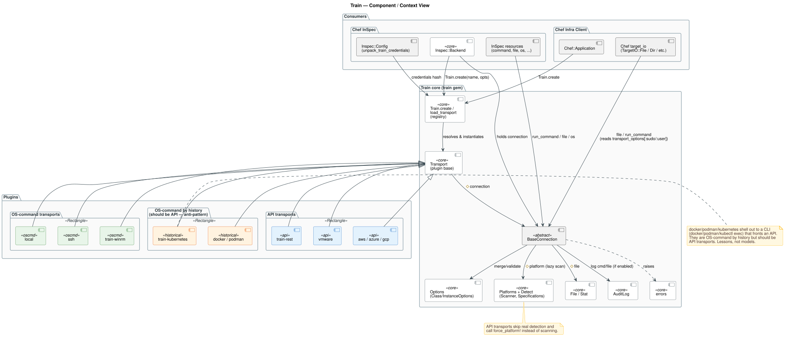
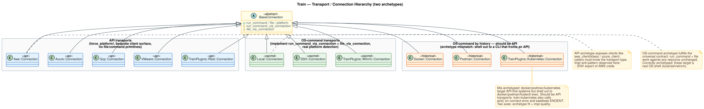
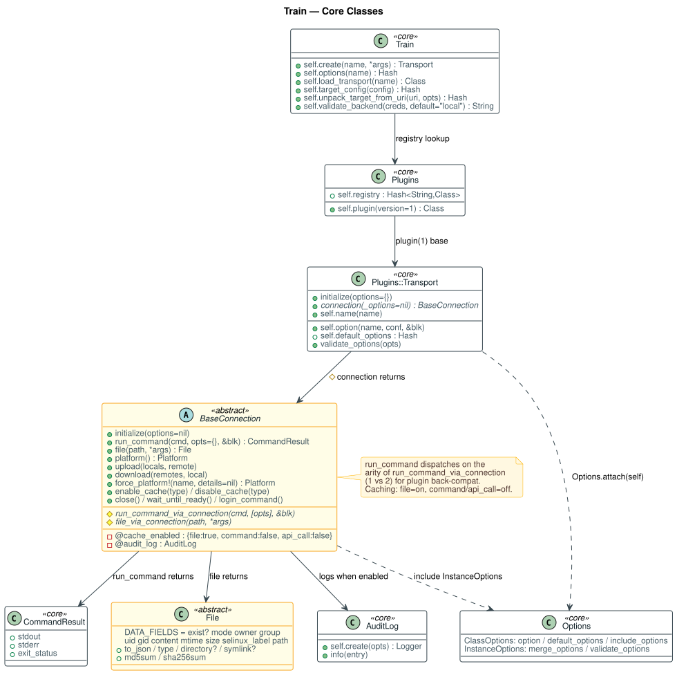
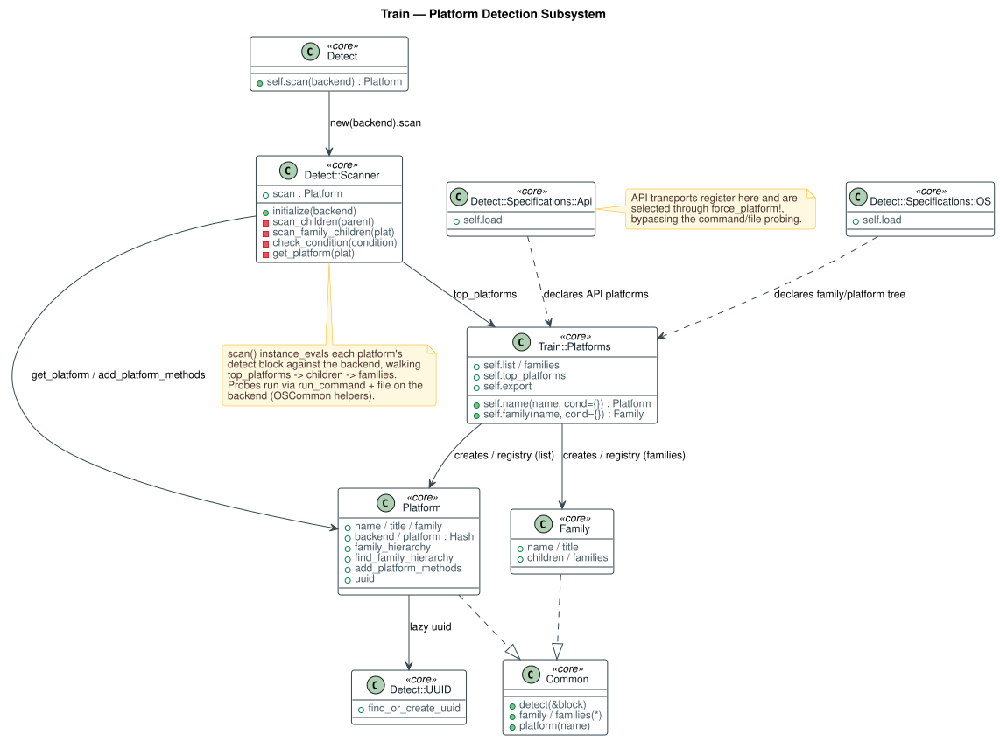
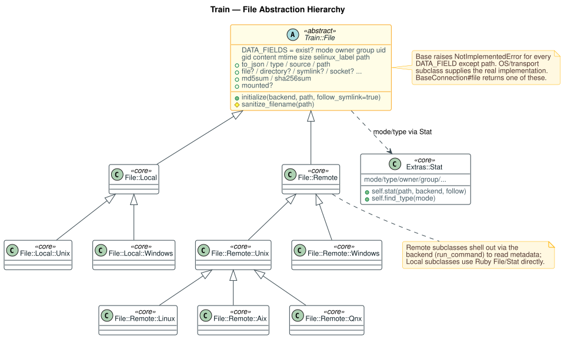
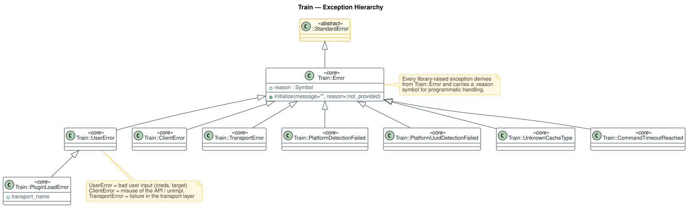
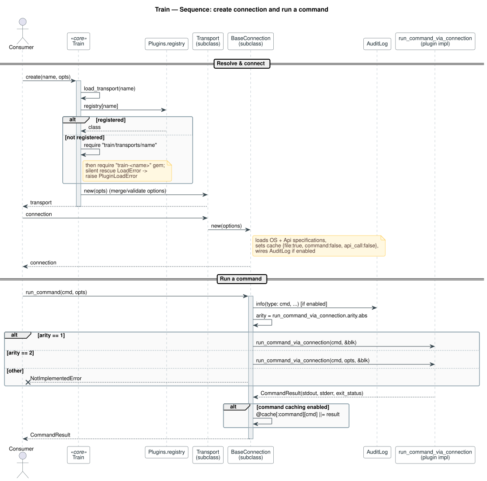
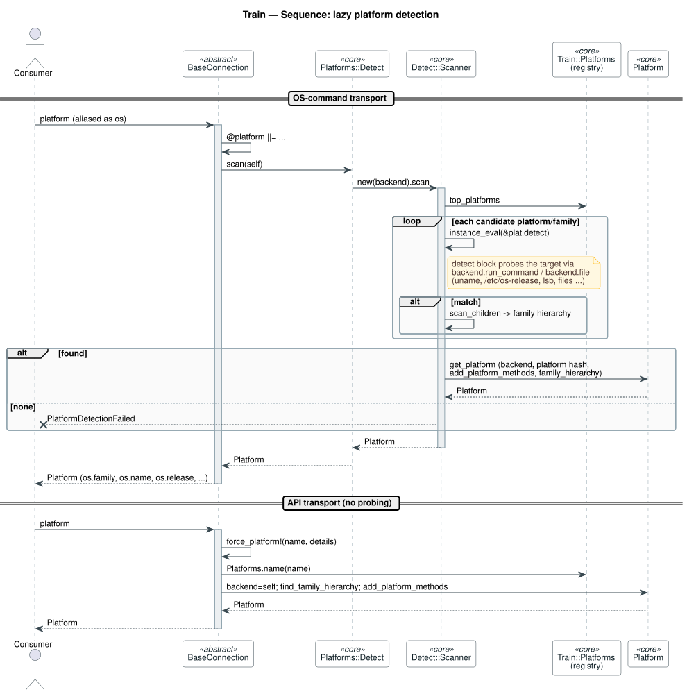

# Train — Architecture Overview (for Implementors & Designers)

This document is a **visual, structural tour** of the Train transport library. It
is aimed at people who need to *extend* Train — write a transport/plugin, add
platform support, or reason about how a change ripples through consumers — and at
designers who need an accurate mental model of the moving parts.

It intentionally stays lean on prose: the deep, prescriptive guidance lives in the
shared, cross-repo product area under
[`context/shared/by-product/train/`](../../shared/by-product/train/background/product.md).
This page shows **how the pieces fit together**; those docs tell you **what to do
about it**.

> **Diagrams are rendered from source.** Every image below is generated from a
> PlantUML `.puml` file in [`diagrams/`](diagrams). See
> [Regenerating the diagrams](#regenerating-the-diagrams) at the end.

---

## 1. The one-paragraph model

Train is a **unified transport contract**. `Train.create(name, opts)` resolves a
named transport through a plugin **registry**, builds a `Transport`, and hands back
a `BaseConnection` subclass. Consumers (Chef InSpec, Chef Infra Client) then use a
tiny, stable surface on that connection — `run_command`, `file`, and `platform`
(aliased `os`) — without knowing which transport is underneath. Options handling,
lazy platform detection, optional caching, and audit logging are all provided by
the base class.

### 1.1 Component / context

How Train sits between its consumers and its plugins, and the single most important
structural fact — plugins split into **two archetypes**.



- **Consumers** — InSpec builds its backend and resources on the connection;
  `Inspec::Config` unpacks credentials before calling `Train.create`. Chef's
  `target_io` layer routes file/dir/command operations through a Train connection
  and reads `transport_options[:sudo]`/`[:user]` off it.
- **Core** — the registry + `Transport` + `BaseConnection`, plus `Options`,
  `Platforms`/`Detect`, `File`/`Stat`, `AuditLog`, and the error taxonomy.
- **Plugins** — see the archetype split below.

See: [`design/architecture.md`](../../shared/by-product/train/design/architecture.md),
[`domains/integration-inspec.md`](../../shared/by-product/train/domains/integration-inspec.md),
[`domains/integration-chef.md`](../../shared/by-product/train/domains/integration-chef.md).

---

## 2. The two plugin archetypes

The single most useful lens for understanding (and correctly extending) Train:

| | **OS-command transports** | **API transports** |
|---|---|---|
| Examples | `local`, `ssh`, `docker`, `podman`, `train-winrm`, `train-kubernetes` | `aws`, `azure`, `gcp`, `vmware`, `train-rest` |
| Implements | `run_command_via_connection` **and** `file_via_connection` | neither |
| Platform | **real detection** via the Scanner | `force_platform!` (hardcoded) |
| Consumer surface | universal — `run_command`/`file` work unchanged | **bespoke** clients (`aws_client(klass)`, REST verbs, …) |



If you are writing a plugin, **decide which archetype you are** first — it
determines almost everything else. Full treatment:
[`design/plugin-archetypes.md`](../../shared/by-product/train/design/plugin-archetypes.md).

---

## 3. Core building blocks

The classes an implementor actually touches, with the methods that matter.



- **`Train` (module)** — entry points: `create`, `options`, `load_transport`,
  and the target/credential helpers (`target_config`, `unpack_target_from_uri`,
  `validate_backend`).
- **`Plugins` / `Plugins::Transport`** — `Plugins.registry` maps names to classes;
  a transport registers itself with `name "foo"`. `Transport#connection` is the
  abstract factory you override.
- **`BaseConnection`** — the heart. Public `run_command` / `file` / `platform`
  wrap the private `*_via_connection` methods with **audit logging** and
  **caching**; `force_platform!` is the API-archetype escape hatch.
- **`Options`** — `Options.attach(klass)` mixes in the `option`/`default_options`
  DSL and `merge_options`/`validate_options`.
- **`CommandResult`** — `Struct.new(:stdout, :stderr, :exit_status)`; the universal
  return of `run_command`.
- **`File`** — abstract; declares `DATA_FIELDS` and raises `NotImplementedError`
  for each until a subclass supplies it.
- **`AuditLog`** — optional structured logging of commands, file access, and
  uploads.

Interface references:
[`interfaces/connection-api.md`](../../shared/by-product/train/interfaces/connection-api.md),
[`interfaces/command-primitive.md`](../../shared/by-product/train/interfaces/command-primitive.md),
[`interfaces/file-primitive.md`](../../shared/by-product/train/interfaces/file-primitive.md),
[`interfaces/options-and-targets.md`](../../shared/by-product/train/interfaces/options-and-targets.md).

---

## 4. Platform detection

Detection is **lazy** (first call to `platform`/`os`) and driven by a `Scanner`
that walks a declarative tree of `Platform`/`Family` specifications, `instance_eval`-ing
each `detect` block against the live backend.



Key facts for anyone adding platform support:

- Specifications live in `Detect::Specifications::OS` and `::Api` and register into
  `Train::Platforms.list` / `.families`.
- The Scanner starts from `top_platforms` and descends children/families, using
  `run_command` + `file` probes (uname, `/etc/os-release`, lsb, file existence…).
- API transports **do not** run this — they call `force_platform!` and select an
  entry from the API specifications directly.

See: [`design/platform-detection.md`](../../shared/by-product/train/design/platform-detection.md),
[`advice/platform-support.md`](../../shared/by-product/train/advice/platform-support.md).

---

## 5. The File abstraction

`BaseConnection#file` returns a `Train::File` subclass. The base is deliberately
abstract; Local subclasses read metadata with Ruby directly, Remote subclasses shell
out through the backend.



See: [`interfaces/file-primitive.md`](../../shared/by-product/train/interfaces/file-primitive.md),
[`interfaces/os-file-command-differences.md`](../../shared/by-product/train/interfaces/os-file-command-differences.md).

---

## 6. Error taxonomy

Every library-raised exception derives from `Train::Error` and carries a `:reason`
symbol, so callers can branch on cause rather than message text.



- `UserError` — bad user input (credentials, target). `PluginLoadError` is a
  `UserError` and carries `transport_name`.
- `ClientError` — API misuse / unimplemented method.
- `TransportError` — failures inside the transport layer.

See: [`interfaces/error-taxonomy.md`](../../shared/by-product/train/interfaces/error-taxonomy.md).

---

## 7. Request flows

### 7.1 Create a connection and run a command

Note the two behaviors that surprise newcomers: the **silent plugin-load fallback**
(registry → core require → `train-<name>` gem → `PluginLoadError`), and the
**arity dispatch** in `run_command` that keeps older single-argument plugins working.



Caching defaults are `{ file: true, command: false, api_call: false }` — file reads
are cached by default, commands are not.

See: [`design/connection-lifecycle.md`](../../shared/by-product/train/design/connection-lifecycle.md),
[`design/caching.md`](../../shared/by-product/train/design/caching.md),
[`advice/audit-logging.md`](../../shared/by-product/train/advice/audit-logging.md).

### 7.2 Lazy platform detection



---

## 8. Extension points & invariants (read before you build)

- **Pick an archetype.** OS-command transports must implement *both*
  `run_command_via_connection` and `file_via_connection` and support real
  detection. API transports call `force_platform!` and expose their own client.
- **Return the contract types.** `run_command` must return a `CommandResult`
  (`stdout`, `stderr`, `exit_status`); `file` must return a `Train::File`.
- **Respect option handling.** Declare options with `option`, rely on
  `merge_options`/`validate_options`; don't mutate `@options` behind the base
  class's back after `super`.
- **Never kill the host process.** Fail with a `Train::TransportError` — do not
  call `exit`, and don't leak credentials into global `ENV`.
- **Prefer `transport://credset` targets.** Let `unpack_target_from_uri` do the
  URL parsing; don't invent a new field mapping.
- **Honor the error taxonomy.** Raise the right `Train::Error` subclass with a
  `:reason`.

These invariants (and the concrete anti-patterns observed in shipping plugins —
ENV credential leaks, `exit`-on-error, post-`super` option mutation, silent
`rescue LoadError`, "no validation whatsoever" in `validate_backend`) are catalogued
with fixes in:

- [`advice/writing-a-plugin.md`](../../shared/by-product/train/advice/writing-a-plugin.md) — the authoring hub
- [`advice/anti-patterns.md`](../../shared/by-product/train/advice/anti-patterns.md)
- [`advice/credentials-handling.md`](../../shared/by-product/train/advice/credentials-handling.md)
- [`advice/url-targets.md`](../../shared/by-product/train/advice/url-targets.md)
- [`advice/sudo-and-command-wrappers.md`](../../shared/by-product/train/advice/sudo-and-command-wrappers.md)
- [`advice/testing-plugins.md`](../../shared/by-product/train/advice/testing-plugins.md)
- [`advice/api-stability.md`](../../shared/by-product/train/advice/api-stability.md)
- [`advice/plugin-packaging.md`](../../shared/by-product/train/advice/plugin-packaging.md)

For testing Train itself, see the repo-local
[`context/local/standards/testing.md`](../standards/testing.md).

---

## Regenerating the diagrams

Sources are PlantUML (`diagrams/*.puml`), sharing the skin in
`diagrams/_style.puml`. They are rendered to SVG with `plantuml.jar` and Graphviz
`dot`.

```bash
# from the repo root; requires Java + Graphviz dot on PATH
# (plantuml.jar is not committed — fetch it into tmp/ first)
curl -sSL -o tmp/plantuml.jar \
  https://repo1.maven.org/maven2/net/sourceforge/plantuml/plantuml/1.2024.7/plantuml-1.2024.7.jar

cd context/local/architecture/diagrams
java -jar ../../../../tmp/plantuml.jar -tsvg -nometadata *.puml
```

When you change Train's structure, **update the relevant `.puml` and re-render** so
the diagrams stay faithful to the code. These diagrams are drawn from the actual
implementation (arity shim, archetype split, `force_platform!`), not an idealized
design — keep them honest.

### Diagram index

| # | Source | Shows |
|---|--------|-------|
| 01 | [`01-component-context.puml`](diagrams/01-component-context.puml) | Consumers → core → plugins by archetype |
| 02 | [`02-core-classes.puml`](diagrams/02-core-classes.puml) | Core classes & associations |
| 03 | [`03-transport-hierarchy.puml`](diagrams/03-transport-hierarchy.puml) | Connection inheritance; two archetypes |
| 04 | [`04-platform-detection.puml`](diagrams/04-platform-detection.puml) | Detect/Scanner/Specifications/Platform/Family |
| 05 | [`05-file-hierarchy.puml`](diagrams/05-file-hierarchy.puml) | `Train::File` subclass tree + Stat |
| 06 | [`06-error-hierarchy.puml`](diagrams/06-error-hierarchy.puml) | `Train::Error` taxonomy |
| 07 | [`07-seq-run-command.puml`](diagrams/07-seq-run-command.puml) | create → connect → run_command |
| 08 | [`08-seq-platform-detect.puml`](diagrams/08-seq-platform-detect.puml) | Lazy platform detection scan |
