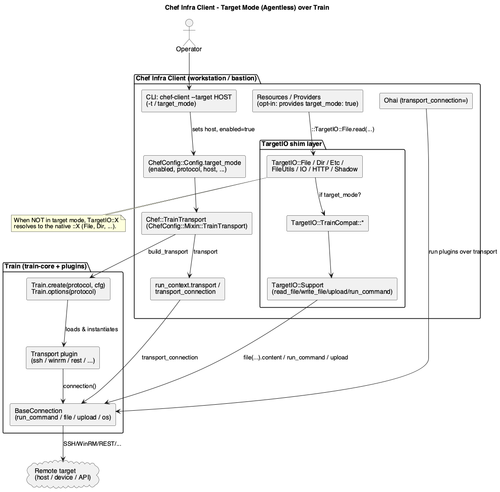
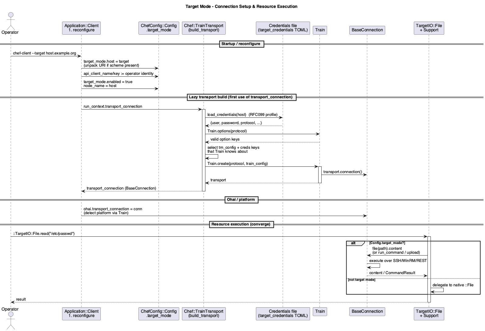
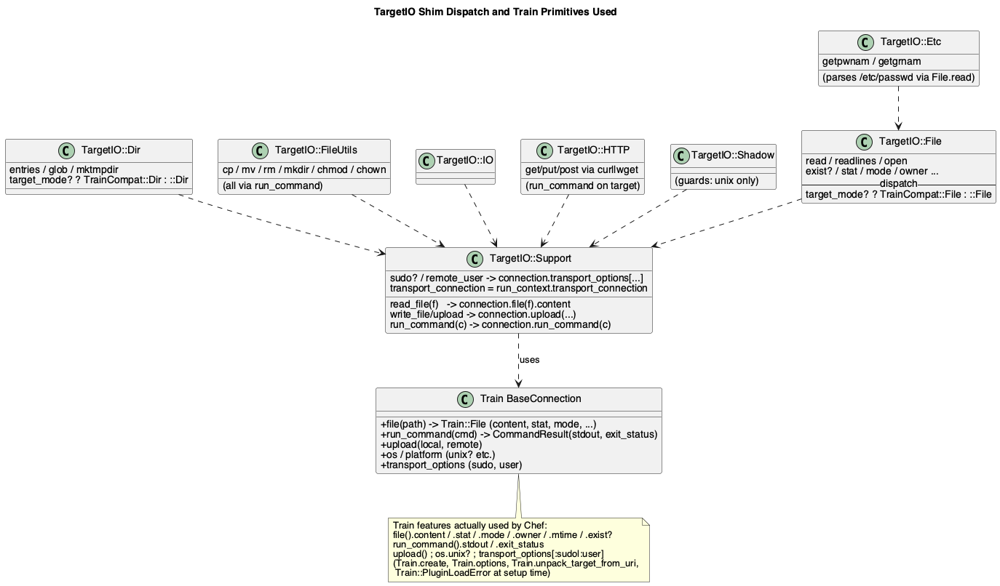

# Chef Infra Client "Target Mode" (Agentless) and its reliance on Train

> Scope & sourcing: this document analyzes how Chef Infra Client's **Target Mode** (informally
> "Agentless") uses **Train**. It is based on a full clone of `chef/chef` (branch `main`) at
> `context/reference-repos/chef`, cross-referenced with the Train source and the Train Plugin
> V1 analysis in `../design/plugins-v1.md`. Every claim below cites a concrete file/path in
> the Chef tree. The final section is a deliberately critical assessment.

## Contents

1. [What "Target Mode" is](#1-what-target-mode-is)
2. [How it is turned on (config & CLI)](#2-how-it-is-turned-on-config--cli)
3. [The connection: `Chef::TrainTransport` → `Train.create`](#3-the-connection-cheftraintransport--traincreate)
4. [Credentials (RFC-099 profiles)](#4-credentials-rfc-099-profiles)
5. [The TargetIO shim layer](#5-the-targetio-shim-layer)
6. [Exactly which Train features Chef uses](#6-exactly-which-train-features-chef-uses)
7. [Resource opt-in & platform detection](#7-resource-opt-in--platform-detection)
8. [Where plugins fit in the ecosystem](#8-where-plugins-fit-in-the-ecosystem)
9. [End-to-end flow](#9-end-to-end-flow)
10. [Critical assessment](#10-critical-assessment)
11. [Appendix: file map & source references](#appendix-file-map--source-references)

---

## 1. What "Target Mode" is

Normally Chef Infra Client runs **on** the node it configures (an installed agent). **Target
Mode** inverts this: the client process runs on a workstation/bastion and manages a **remote**
target — a server you can't or don't want to install Ruby/Chef on (a network device, an
appliance, a locked-down host, or an API). This is the "agentless" story.

The mechanism is: instead of touching the local filesystem and running local commands, Chef
routes its I/O and command execution **through a Train connection** to the remote target. The
`--target` option was designed as the entry point (`lib/chef/application/base.rb:219`, an
`option :target`), and the feature is labeled internally as "RFCxxx Target Mode support"
(`chef-config/lib/chef-config/config.rb`, just above `config_context :target_mode`).

Train is the *only* remoting layer used — Chef does not implement its own SSH/WinRM. Chef's
gemspec makes the dependency explicit (`chef.gemspec:46-48`):

```ruby
s.add_dependency "train-core", "~> 3.13", ">= 3.13.4"
s.add_dependency "train-winrm", ">= 0.2.17"
s.add_dependency "train-rest", ">= 0.4.1" # target mode with rest APIs
```

So Chef ships `train-core` (which contains the `ssh`, `local`, `docker`, … transports) plus
the `train-winrm` and `train-rest` plugin gems out of the box.



## 2. How it is turned on (config & CLI)

Target Mode is a **config context** in `chef-config`
(`chef-config/lib/chef-config/config.rb`):

```ruby
configurable(:target)          # the --target shortcut value

config_context :target_mode do
  config_strict_mode false     # do NOT validate keys — accept arbitrary Train options
  default :enabled, false
  default :protocol, "ssh"     # default transport
  # typical additional keys: host, user, password
end

def self.target_mode?
  target_mode.enabled
end
```

Two things are load-bearing here:

- **`config_strict_mode false`** — the `target_mode` context intentionally accepts *any* key,
  because those keys are really **Train transport options** (host, user, password, port,
  `winrm_transport`, etc.). Chef does not want to enumerate every Train option, so it lets
  them pass through and filters them later against `Train.options(protocol)` (see §3).
- **`protocol` defaults to `"ssh"`** — i.e. the default Train transport is SSH.

The CLI wires `--target` in `Chef::Application::Client#reconfigure`
(`lib/chef/application/client.rb:122-138`):

```ruby
if config[:target] || Chef::Config.target
  require "ed25519" # net-ssh ed25519 key support
  Chef::Config.target_mode.host = config[:target] || Chef::Config.target
  if URI.parse(Chef::Config.target_mode.host).scheme
    train_config = Train.unpack_target_from_uri(Chef::Config.target_mode.host)
    Chef::Config.target_mode = train_config
  end
  # Capture the OPERATOR's Chef Server identity before target mode rewrites paths
  Chef::Config[:api_client_name] ||= Chef::Config[:node_name]
  Chef::Config[:api_client_key]  ||= Chef::Config[:client_key]
  Chef::Config.target_mode.enabled = true
  Chef::Config.node_name = Chef::Config.target_mode.host
end
```

Notable details:

- If `--target` is a **URI** (e.g. `winrm://user@host`), Chef calls
  **`Train.unpack_target_from_uri`** — a *Train* helper — to split scheme/host/user/password
  into the `target_mode` hash. This is a direct reuse of Train's URI credential parser.
- The **node identity is remapped**: `node_name` becomes the target host, and the operator's
  original Chef Server API credentials are preserved in `api_client_name`/`api_client_key`
  (`config.rb:490-493`). This is a subtle but important consequence — the Chef Server still
  authenticates as the operator, while the *node object* is named after the target. Cache
  paths are also namespaced by target host (`config.rb:382-386`, `428`).

## 3. The connection: `Chef::TrainTransport` → `Train.create`

The connection object is created lazily and memoized on the run context
(`lib/chef/run_context.rb:660-674`):

```ruby
def transport                              # Train transport plugin instance
  @transport ||= Chef::TrainTransport.new(logger).build_transport
end

def transport_connection                   # Train BaseConnection
  @transport_connection ||= transport&.connection
end
```

`Chef::TrainTransport` (`lib/chef/train_transport.rb`) is a thin wrapper that mixes in the
real logic from `ChefConfig::Mixin::TrainTransport`
(`chef-config/lib/chef-config/mixin/train_transport.rb`). The heart is `build_transport`:

```ruby
def build_transport
  return nil unless config.target_mode?

  tm_config    = config.target_mode
  credentials  = load_credentials(tm_config.host)         # RFC-099 profile (see §4)
  protocol     = credentials&.dig(:transport_protocol) || tm_config.protocol

  # Keep ONLY keys that the chosen Train transport actually understands:
  train_config = tm_config.to_hash.select { |k| Train.options(protocol).key?(k) }

  if credentials
    valid_settings = credentials.select { |k| Train.options(protocol).key?(k) }
    valid_settings[:enable_password] = credentials[:enable_password] if credentials.key?(:enable_password)
    train_config.merge!(valid_settings)
  end

  train_config[:logger] = logger
  Train.create(protocol, train_config)                    # <-- the Train handshake
rescue SocketError => e
  e.message.replace "Error connecting to #{train_config[:target]} via #{protocol} - #{e.message}"
  raise e
rescue Train::PluginLoadError
  logger.error("Invalid target mode protocol: #{protocol}")
  exit(1)
end
```

This single method is where almost all of Chef's *setup-time* dependence on Train lives. The
Train API surface used here:

| Train API | Used for |
|---|---|
| `Train.options(protocol)` | Discover the option schema of the transport, to filter Chef config down to keys the transport accepts. Called for **both** the config context and the credentials file. |
| `Train.create(protocol, cfg)` | Load the transport plugin (by name = `protocol`) and instantiate it with the merged options. Returns a `Train::Plugins::Transport`. |
| `Train::PluginLoadError` | Distinguish "unknown/uninstalled transport" from other failures → friendly error + `exit(1)`. |
| `Train.unpack_target_from_uri` | (in the CLI, §2) parse a `scheme://…` target into credential fields. |
| `transport.connection` | (in run_context) obtain the `BaseConnection`. |

The comment *"Train handles connection retries for us"* is telling: Chef deliberately offloads
retry/backoff to the transport plugin rather than owning it.



## 4. Credentials (RFC-099 profiles)

Target credentials live in a **TOML** file of named profiles (one per target), following the
Chef RFC-099 "credentials" convention. `ChefConfig::Mixin::TrainTransport` (via
`ChefConfig::Mixin::Credentials`) resolves the file with this precedence
(`credentials_file_path`):

1. `ENV["CHEF_CREDENTIALS_FILE"]`
2. `target_mode.credentials_file`
3. `/etc/chef/<TARGET_HOST>/credentials`
4. `$HOME/.chef/target_credentials`

`load_credentials(profile)` parses the TOML, symbolizes keys "to match `Train.options()`", and
warns about a very common mistake — an unquoted FQDN like `[host.example.org]` becomes a
nested TOML table instead of a profile name (`contains_split_fqdn?`). A profile can override
the transport with a `transport_protocol` key, which is why `build_transport` prefers
`credentials[:transport_protocol]` over `target_mode.protocol`.

The important architectural point: **credentials are expressed in Train's vocabulary.** Chef
does not define its own credential schema; a profile is essentially "a bag of Train options"
that is validated against `Train.options(protocol)`.

## 5. The TargetIO shim layer

Setting up a connection is only half the story. For a *converge* to work agentlessly, every
place in Chef that would normally touch `File`, `Dir`, `Etc`, `FileUtils`, `IO`, HTTP, or the
shadow password DB must transparently redirect to the remote target. Chef does this with a
**`TargetIO::*` shim layer** (`lib/chef/target_io/`).

Each shim is a constant that resolves to either the native class or a Train-backed compat
class, keyed on `Config.target_mode?`. For example `lib/chef/target_io/file.rb`:

```ruby
backend = ChefConfig::Config.target_mode? ? TrainCompat::File : ::File
```

The same pattern appears for `Dir`, `Etc`, `IO`, `FileUtils`, `Shadow`
(`target_io/{dir,etc,io,fileutils,shadow}.rb`). Providers are written against
`::TargetIO::File`, `::TargetIO::Dir`, etc., so the *same provider code* runs locally or
remotely with no branching (e.g. `lib/chef/provider/file.rb:103,402` uses `::TargetIO::File`).

The Train-backed implementations live under `lib/chef/target_io/train/` and all funnel through
`TargetIO::Support` (`lib/chef/target_io/support.rb`), which is the actual adapter to the Train
connection:

```ruby
def read_file(filename)
  # sudo path stages the file into a readable temp dir first
  transport_connection.file(accessible_file).content
end
def write_file(remote, content)   # tempfile -> upload
  upload(tempfile.path, remote)
end
def upload(local, remote)         # transport_connection.upload(...)
def run_command(cmd)              # transport_connection.run_command(cmd)
def sudo?                          transport_connection.transport_options[:sudo]  end
def remote_user                    transport_connection.transport_options[:user]  end
def transport_connection           Chef.run_context&.transport_connection         end
```

Highlights of the compat classes:

- **`TrainCompat::File`** (`target_io/train/file.rb`) is the richest. `read`/`readlines` go
  through `Support#read_file` → `connection.file(path).content`. A large `method_missing`
  routes: `stat`/`lstat` → `connection.file(path, follow_symlink).stat` (wrapped in an
  `OpenStruct`); `mode`/`owner`/`group`/`uid`/`gid`/`size`/`selinux_label` →
  `connection.file(path).stat[...]`; `mtime` → `connection.file(path).mtime` (converted to a
  `Time`); `exist?`/`file?`/`symlink?`/etc. → `connection.file(path).send(...)`; write-ish
  ops (`chmod`, `chown`, `delete`, `symlink`) are **redirected to `TargetIO::FileUtils`**
  (i.e. remote shell commands). Pure path math (`join`, `dirname`, `extname`) is done
  **locally**.
- **`TrainCompat::FileUtils`** (`target_io/train/fileutils.rb`) implements ~16 operations by
  **shelling out** (`run_command("cp …")`, `mv`, `rm`, `mkdir`, `chmod`, `chown`, …).
- **`TrainCompat::Etc`** (`target_io/train/etc.rb`) has **no Train primitive of its own** — it
  reads `/etc/passwd` and `/etc/group` via `TargetIO::File.read` and parses them in Ruby
  (the parser is explicitly *"Courtesy of InSpec"*), reconstructing `Etc::Passwd`/`Etc::Group`
  structs. This is a strong signal of the InSpec/Train lineage.
- **`TrainCompat::HTTP`** (`target_io/train/http.rb`) is the most surprising: there is **no
  HTTP transport primitive in Train**, so Chef synthesizes HTTP by running `curl`/`wget` **on
  the target** via `run_command` (it even `which`es for the binary first). `remote_file` over
  HTTP in target mode therefore requires curl/wget on the target.
- **`TrainCompat::Shadow`** and `Etc` guard with `!transport_connection.os.unix?` (they raise
  or bail on non-Unix), using Train's platform detection.



## 6. Exactly which Train features Chef uses

Distilling §3–§5, the **complete** set of Train capabilities Chef depends on:

**Setup time (once, in `build_transport`/CLI):**
- `Train.options(name)` — option schema introspection (used to filter config + credentials).
- `Train.create(name, opts)` — plugin load + transport instantiation.
- `Train.unpack_target_from_uri(uri)` — URI → credential fields.
- `Train::PluginLoadError` — error taxonomy.
- `transport.connection` — obtain the `BaseConnection`.

**Runtime (per operation, via `TargetIO::Support` + compat classes):**
- `connection.run_command(cmd)` → `CommandResult` (`.stdout`, `.exit_status`). The single most
  used primitive (all of `FileUtils`, `HTTP`, parts of `File`/`Dir`).
- `connection.file(path[, follow_symlink])` → a `Train::File`, from which Chef reads
  `.content`, `.stat`, `.mode`, `.owner`, `.group`, `.uid`, `.gid`, `.size`,
  `.selinux_label`, `.mtime`, `.exist?`, `.file?`, `.symlink?`, `.block_device?`,
  `.character_device?`.
- `connection.upload(local, remote)` — file writes (via a local tempfile then upload; `sudo`
  writes stage through a temp dir).
- `connection.os` / `connection.platform` — platform gating (`.unix?`), also handed to Ohai.
- `connection.transport_options[:sudo | :user]` — privilege/user awareness.

Notably Chef does **not** use Train's caching API, `login_command`, `wait_until_ready`, or the
JSON marshalling — it treats the connection as a live command/file/upload pipe plus a platform
oracle.

## 7. Resource opt-in & platform detection

**Not every resource works in target mode.** Availability is gated in `Chef::NodeMap`
(`lib/chef/node_map.rb`). The `set` signature carries two mode flags
(`node_map.rb:69`): `target_mode: nil` (default) and `agent_mode: true` (default). Matching
logic (`node_map.rb:255-283`):

```ruby
def matches_target_mode?(filters)
  return true unless Chef::Config.target_mode?
  !!filters[:target_mode]        # must explicitly opt in
end
def matches_agent_mode?(filters)
  return true if Chef::Config.target_mode?
  !!filters[:agent_mode]         # default true
end
```

So in target mode a resource is only selected if it was registered with
`target_mode: true`. Resources opt in through their `provides` call, e.g.
`lib/chef/resource/apt_package.rb:25-27`:

```ruby
provides :apt_package, target_mode: true
provides :package, platform_family: "debian", target_mode: true
target_mode support: :full
```

At the time of writing, **94** resource files declare `target_mode: true`
(`grep -rlE 'target_mode:\s*true' lib/chef/resource/ | wc -l`). `Resource.target_mode`
(`lib/chef/resource.rb:1495`) is a *documentation-only* keyword recording the support level
(`:full`, etc.) surfaced by `resource_inspector`.

**Platform detection** in target mode is delegated to Ohai *running over the Train
connection*: `lib/chef/client.rb:614` sets `ohai.transport_connection = transport_connection if
Chef::Config.target_mode?`. Individual shims also consult `transport_connection.os` directly
(e.g. `target_io/etc.rb`, `target_io/shadow.rb` require `os.unix?`). Thus Train's platform
family/`force_platform!` machinery (see `../design/plugins-v1.md` §6) becomes Chef's notion of
the target's OS.

## 8. Where plugins fit in the ecosystem

Target Mode consumes Train **transport plugins** exactly as any Train host would (see the V1
plugin model in `../design/plugins-v1.md`). The `protocol` config value *is* the plugin's
registered `name`:

- `protocol "ssh"` / `"winrm"` / `"local"` / `"docker"` → transports bundled in `train-core`
  or the `train-winrm` gem Chef depends on.
- `protocol "rest"` → the `train-rest` gem (Chef ships it specifically for "target mode with
  rest APIs", per the gemspec comment).
- **Any third-party `train-<name>` gem** works automatically: `Train.create(protocol, …)`
  will `require "train-<name>"` on a registry miss (Train's loader, `lib/train.rb`), so
  installing a plugin gem is enough to add a new Chef target type. No Chef-side change is
  required.

Conversely, a plugin must satisfy the runtime contract Chef relies on (§6). A **pure-API
transport** like `train-aws` (which implements *neither* `run_command_via_connection` nor
`file_via_connection`; see `../design/plugins-v1.md` §12.3) is essentially unusable for a
general Chef converge — the `TargetIO` shims would call `run_command`/`file` and hit
`NotImplementedError`. This is why the practically useful Chef target transports are the
shell/file-capable ones (ssh, winrm, and command-shims like k8s), while REST targets are
handled by purpose-built resources (e.g. the `*_api`/inspec resources) rather than the generic
file/command providers.

There is also a **naming/adjacency subtlety** worth calling out: the InSpec resource-pack
gems (e.g. `inspec-gcp-resources`, which sit on top of a Train transport such as the in-core
`gcp` transport described in `../design/plugins-v1.md` §12.5) are **not** Train plugins and
play no role in Chef Target Mode's transport; they belong to InSpec's own plugin system. Chef Target Mode ↔ Train transport plugins is a strictly separate axis from
InSpec ↔ resource packs, even though both ecosystems share Train and overlap in code lineage
(the `/etc/passwd` parser "Courtesy of InSpec" is a visible seam).

## 9. End-to-end flow

1. Operator runs `chef-client --target host` (or sets `target_mode` in config).
2. `Application::Client#reconfigure` sets `target_mode.host`, optionally unpacks a URI via
   `Train.unpack_target_from_uri`, preserves the operator's Chef Server identity, flips
   `target_mode.enabled = true`, and renames the node to the target.
3. On first access to `run_context.transport_connection`, `Chef::TrainTransport#build_transport`
   loads the RFC-099 credentials profile, chooses the `protocol`, filters config+credentials
   through `Train.options(protocol)`, and calls `Train.create(protocol, cfg)` → `.connection`.
4. Ohai is given the connection and detects the target's platform over Train.
5. During converge, only resources registered `target_mode: true` are available. Their
   providers use `::TargetIO::{File,Dir,Etc,FileUtils,IO,HTTP,Shadow}`.
6. Each `TargetIO` call resolves to a `TrainCompat` class → `TargetIO::Support` →
   `transport_connection.{file,run_command,upload}` → the transport plugin → the target.
7. Reads return `Train::File#content`/`#stat`; commands return `CommandResult`; writes go
   through a local tempfile + `upload` (staged through a temp dir when `sudo`).

## 10. Critical assessment

Strengths:

- **Clean separation of concerns.** Chef owns *what* to do (resources/providers) and defers
  *how to reach the target* entirely to Train. The `TargetIO` indirection means the vast
  majority of provider code is transport-agnostic — the same `provider/file.rb` runs locally
  or remotely. That is a genuinely elegant reuse of the Train abstraction.
- **Zero-integration plugin extensibility.** Because `protocol` maps to a Train plugin name
  and Train auto-`require`s `train-<name>`, new target types are added by installing a gem.
  Chef inherits Train's whole plugin ecosystem for free.
- **Options/credentials expressed in Train's vocabulary.** Filtering through
  `Train.options(protocol)` avoids Chef re-declaring every transport's option and keeps the
  two projects loosely coupled.

Weaknesses & risks (the critical part):

1. **The abstraction is leaky and Unix-shell-centric.** Large parts of the compat layer are
   not really "remote I/O" — they are **`run_command` with hardcoded coreutils** (`cp`, `mv`,
   `rm`, `chmod`, `realpath`, `readlink`, `test -r`). `TrainCompat::File#realpath` even notes
   *"coreutils, not MacOSX"*. This silently assumes a POSIX shell with GNU utilities on the
   target, undermining the promise of a uniform transport. WinRM/PowerShell or minimal
   busybox targets will hit gaps.
2. **HTTP is faked via `curl`/`wget` on the target.** `TrainCompat::HTTP` shells out because
   Train has no HTTP primitive. This is fragile (depends on a binary being present and on the
   argument formats), and it explicitly *"does not yet support sending data"* for
   PUT/POST bodies. `remote_file` from an HTTP source in target mode is therefore only
   partially functional.
3. **Capability mismatch with the plugin model.** Train V1 lets a plugin implement *neither*
   files nor commands (e.g. `train-aws`), but Chef's generic providers assume *both*. There is
   no capability negotiation — a resource that isn't target-aware, or a transport that lacks
   `run_command`/`file`, fails at runtime with `NotImplementedError` rather than being
   detected up front. The `target_mode: true` opt-in gate mitigates this only for the 94
   curated resources; everything else is simply absent in target mode.
4. **Performance.** Each `File`/`FileUtils`/`Etc` operation is a separate round trip
   (`run_command` or `file`), and Chef does **not** use Train's caching. A converge that
   touches many files or shells out repeatedly can be very chatty over SSH/WinRM. `Etc`
   re-reads and re-parses `/etc/passwd`/`/etc/group` on every lookup.
5. **`sudo` file writes are non-atomic and racy.** `Support#upload`/`write_file` upload to a
   staging dir then `mv` into place via a *second* command; the staging cleanup swallows
   `Errno::ENOENT`. This is a reasonable workaround for privilege boundaries but weaker than
   Chef's local atomic-write guarantees.
6. **Partial/inconsistent implementation.** The compat classes are peppered with
   `raise NotImplementedError` (`File.new`, block-less `File.foreach`, non-read `File.open`
   modes) and commented-out methods (`ftype`). The surface is "enough to run the curated
   resources," not a complete `File`/`IO` replacement, so third-party cookbooks that reach for
   unsupported stdlib calls will break in subtle ways.
7. **Identity remapping is subtle.** Renaming `node_name` to the target host while keeping the
   operator's API keys (`api_client_name`/`api_client_key`) is clever but easy to
   misconfigure; credentials-file path resolution changes once target mode is enabled, which
   is exactly why the code has to capture the operator identity *before* flipping the flag.
   This ordering dependency is a latent foot-gun.
8. **Reliance on Train internals/lineage.** Parsing `/etc/passwd` "Courtesy of InSpec" and
   depending on `Train::File#stat` shape (wrapped in `OpenStruct`) couples Chef to Train's
   file object semantics beyond the documented `DATA_FIELDS`. Changes in a transport's `stat`
   contents would ripple into Chef.

Bottom line: Target Mode is a **thin, pragmatic remoting adapter** — it leans on Train for the
transport handshake and for `run_command`/`file`/`upload`, then rebuilds a *Unix-flavored*
stdlib on top of `run_command`. It is powerful for SSH/WinRM Unix-like targets and for the
curated resource set, but the "agentless everywhere" ambition is bounded by (a) the
shell-command assumptions baked into the compat layer, (b) the lack of capability negotiation
with the plugin API, and (c) the absence of caching/atomicity guarantees. A future Train
plugin API redesign (the eventual goal of the `../design/` docs) could address several of
these by making capabilities explicit (files? commands? http? atomic writes?) and by offering
first-class primitives (an HTTP verb, a stat contract, batched/streamed I/O) that Chef today
has to synthesize.

## Appendix: file map & source references

Chef side (`context/reference-repos/chef`):

- CLI/enable: `lib/chef/application/base.rb` (`option :target`),
  `lib/chef/application/client.rb:122-138` (reconfigure).
- Config: `chef-config/lib/chef-config/config.rb` (`config_context :target_mode`,
  `target_mode?`, cache-path namespacing, `api_client_name/key`).
- Connection: `lib/chef/run_context.rb:660-674` (`transport`/`transport_connection`),
  `lib/chef/train_transport.rb`,
  `chef-config/lib/chef-config/mixin/train_transport.rb` (`build_transport`,
  `load_credentials`, `credentials_file_path`).
- Shim layer: `lib/chef/target_io/{file,dir,etc,fileutils,io,http,shadow}.rb`,
  `lib/chef/target_io/train_compat.rb`, `lib/chef/target_io/support.rb`,
  `lib/chef/target_io/train/{file,dir,etc,fileutils,http,shadow,io}.rb`.
- Gating & platform: `lib/chef/node_map.rb:69,255-283`,
  `lib/chef/resource.rb:1495` (`target_mode` keyword),
  `lib/chef/resource/apt_package.rb:25-27` (opt-in example),
  `lib/chef/client.rb:614` (Ohai over transport).
- Dependencies: `chef.gemspec:46-48` (`train-core`, `train-winrm`, `train-rest`).

Train side (see also `../design/plugins-v1.md`): `Train.create`, `Train.options`,
`Train.unpack_target_from_uri`, `Train::PluginLoadError`, `BaseConnection#{run_command,file,
upload,os,transport_options}`, `Train::File#{content,stat,mtime,…}`.

Diagram sources: `img/src/*.puml` (regenerate with
`java -jar <plantuml.jar> -tpng -o "$PWD/img" img/src/*.puml`).
